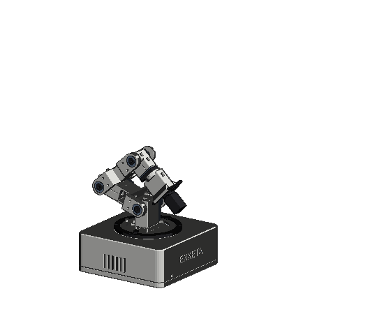
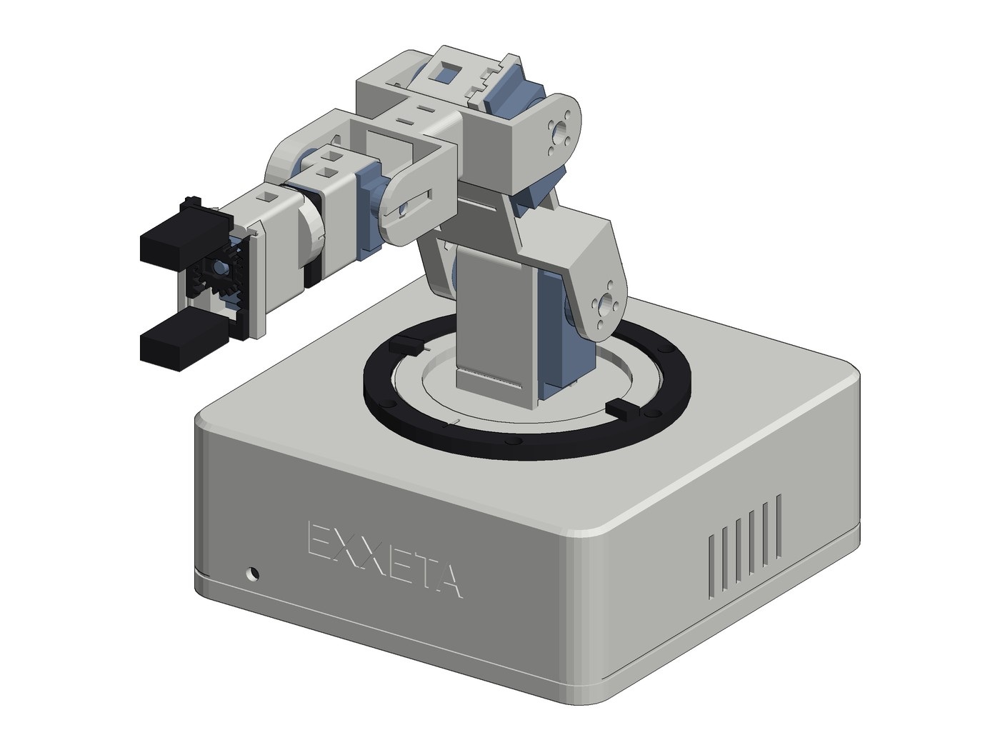
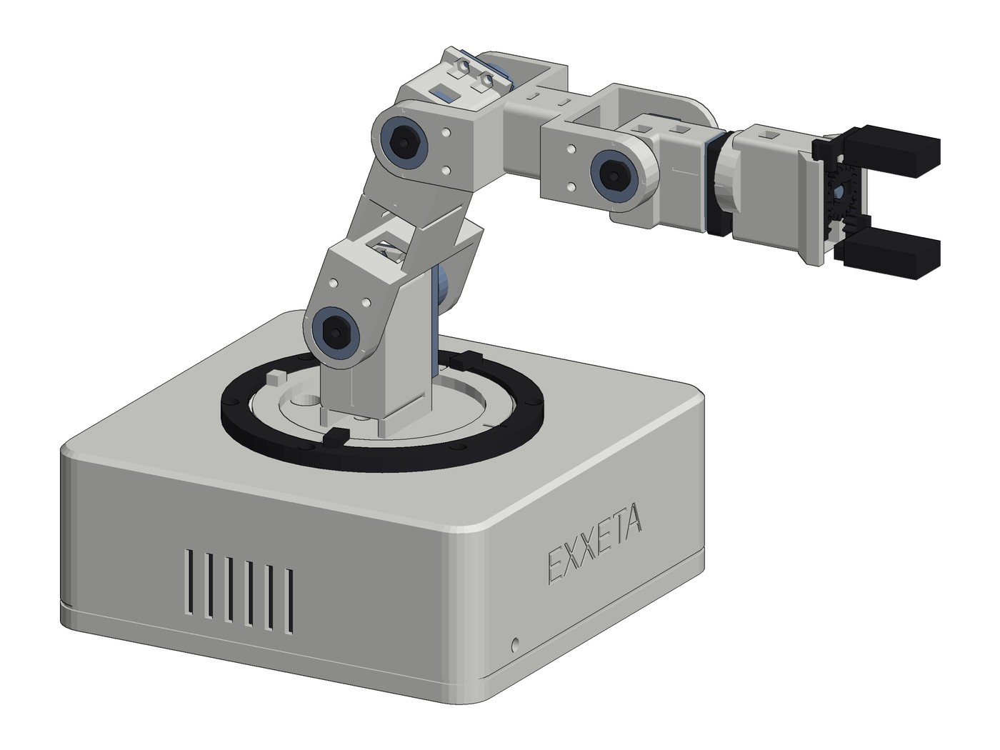
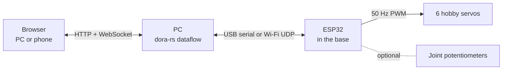
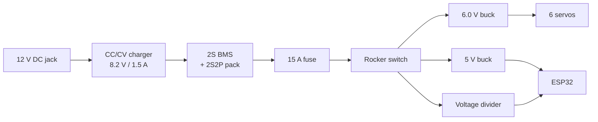
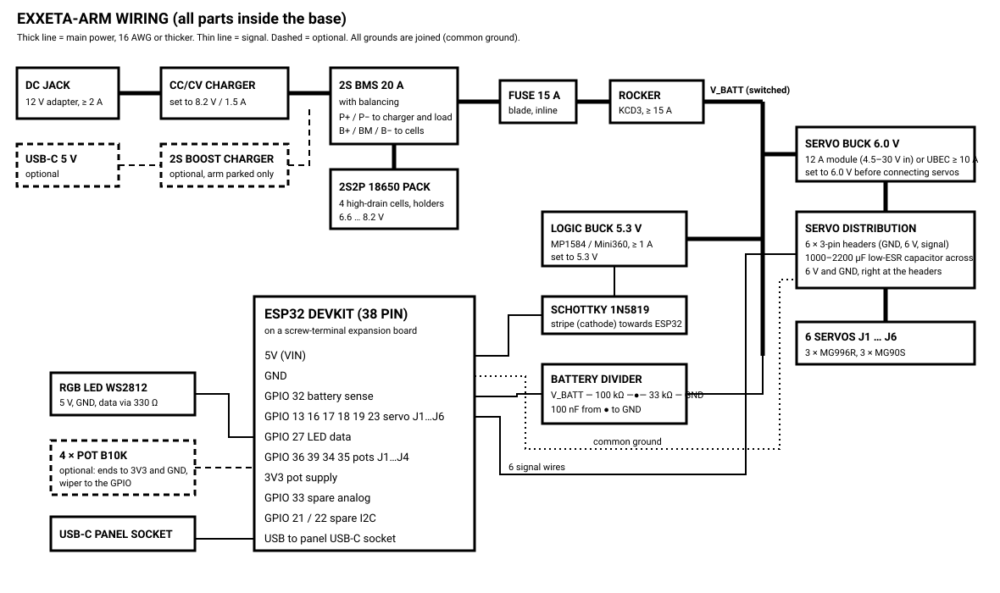

# exxeta-arm

**A low-cost, 3D-printed desktop robot arm built from ordinary hobby servos, controlled from a PC or a phone through a dora-rs dataflow.**

<p align="center">
  
</p>

## Contents

1. [About the project](#1-about-the-project)
2. [At a glance](#2-at-a-glance)
3. [How it works](#3-how-it-works)
4. [Mechanics](#4-mechanics)
5. [Electronics and power](#5-electronics-and-power)
6. [Software](#6-software)
7. [Getting started](#7-getting-started)
8. [Repository structure](#8-repository-structure)

---

## 1. About the project

### 1.1 The idea

Popular open-source arms such as the LeRobot **SO-100 / SO-101** use smart bus servos that report their position. Those servos are not easy to buy everywhere. exxeta-arm has a similar layout but uses **common hobby servos** (MG996R and MG90S), a standard **ESP32** board and other generic parts.

Hobby servos are cheap and available, but they give no position feedback and have limited torque. Much of the design deals with those two limits: the arm is sized by a torque calculation, and software takes care of what the servos cannot report.

### 1.2 What it does

- Moves five joints and a parallel gripper, smoothly and within enforced limits.
- Moves the gripper in **joint space** or along **straight lines** (forward and inverse kinematics).
- Is controlled from **one web app** on a PC or phone, over **USB or Wi-Fi**.
- Shows a live **3D digital twin** of the arm.
- **Records and replays** waypoint programs and continuous motions.
- Runs completely **in simulation**, with no hardware.

### 1.3 What it is for

Besides being a small working arm, it is a **learning platform**. One project covers robotics dataflows ([dora-rs](https://github.com/dora-rs/dora), a lightweight alternative to ROS 2), kinematics, embedded firmware, parametric CAD and electronics. It comes with a [dora tutorial](docs/software/dora_tutorial.md), a [kinematics explainer](docs/design/kinematics.md) and [exercises](docs/learning/exercises.md).

The first version is designed and simulated; the physical arm has not been built yet.

---

## 2. At a glance

### 2.1 Pictures

CAD renders. Light and dark parts are 3D printed; blue parts are servos and bearings.

| | |
|:---:|:---:|
|  |  |

### 2.2 Key specifications

These are design values from the calculations in [docs/design](docs/design).

| | |
|---|---|
| Layout | 5 joints + gripper (6 servos) |
| Reach | 255 mm to the grip centre, 270 mm to the fingertips |
| Rated payload | 50 g at full horizontal reach |
| Gripper | parallel, rack and pinion, opens 0–50 mm |
| Servos | 3 × MG996R, 3 × MG90S |
| Smallest joint safety factor | 2.24 (shoulder), against the rated servo torque |
| Base | 170 × 170 × 65 mm; designed to hold the battery and all electronics |
| Printed mass | about 520 g (PETG) |
| Controller | ESP32 (classic ESP32-WROOM-32, 38-pin DevKit) |
| Connection | USB serial or Wi-Fi, switchable in the app |
| Battery | 2S2P 18650, about 2 h of typical use |

---

## 3. How it works

### 3.1 System overview



- The **PC** does the thinking: kinematics, trajectory planning, safety checks, recording and the web server. A PC is always needed.
- The **ESP32** is a smart I/O device. It turns joint targets into smooth servo motion, enforces limits on its own, and reports its state.
- The **simulator** has the same inputs and outputs as the real arm, so the rest of the software works the same with either.

### 3.2 From button press to movement

1. You press a button in the web app, and the command reaches the `web_server` node.
2. The `planner` turns it into a smooth stream of joint goals, 50 per second.
3. The `safety` node checks every goal: limits, speed, table and base collisions, STOP.
4. The `arm_bridge` sends the safe targets to the ESP32.
5. The firmware moves each servo towards its target with limited speed and acceleration.
6. The state travels back and updates the 3D view.

### 3.3 Working without position feedback

- **Known starting point:** the arm is always parked in a folded **rest pose** before power-off, and it assumes that pose when it is enabled again.
- **Calibration:** alignment marks on the joints let you calibrate each servo by eye, using two points ([guide](docs/build/calibration_guide.md)).
- **Optional sensors:** J1–J4 have mounts for ordinary B10K potentiometers. The arm is designed to work without them.

---

## 4. Mechanics

### 4.1 Joints

| Joint | Function | Servo | Range | Safety factor |
|---|---|---|---|---|
| J1 | base yaw | MG996R | −90° … 90° | 14.0 |
| J2 | shoulder pitch | MG996R | −72° … 90° | 2.24 |
| J3 | elbow pitch | MG996R | −50° … 120° | 4.64 |
| J4 | wrist pitch | MG90S | −85° … 85° | 2.59 |
| J5 | wrist roll | MG90S | −85° … 85° | 6.63 |
| J6 | gripper | MG90S | 0° … 160° (closed … open) | – |

Full calculation: [torque budget](docs/design/torque_budget.md).

### 4.2 How a joint is built

A hobby servo's shaft should not carry bending loads, so each pitch joint is a **fork around a servo housing**. One fork arm is driven by the servo horn and transmits torque. The other rides on a **608 bearing**, directly opposite, and supports the load.

### 4.3 Base bearing

The turntable runs on a **printed ball race with 46 steel balls** (6 mm). It carries weight, side load and tipping moment, so the base servo only has to turn the arm ([details](docs/decisions/ADR-0004-j1-ball-race-and-range.md)).

### 4.4 Gripper

One servo turns a **pinion** that drives two **racks** in opposite directions. The fingers stay parallel and the grip centre stays on the hand axis for every object size ([details](docs/decisions/ADR-0006-rack-and-pinion-gripper.md)).

### 4.5 Parametric CAD

The mechanical design is Python code ([build123d](https://github.com/gumyr/build123d)), driven by one file: [`arm_params.json`](cad/params/arm_params.json). One command regenerates the STL files, the STEP assembly, the URDF robot model and the renders, and runs three checks:

- every part fits a 220 × 220 × 250 mm printer,
- no parts collide in the sampled poses across the joint ranges,
- every joint keeps a safety factor of at least 2.

A Fusion 360 version of the assembly is included as [`exxeta_arm.f3d`](cad/fusion360/exxeta_arm.f3d).

---

## 5. Electronics and power

### 5.1 Main components

| Component | Purpose |
|---|---|
| ESP32 DevKit (38 pin) | controller |
| 4 × 18650 cells + 2S balancing BMS | battery |
| 15 A fuse and rocker switch | protection and main power |
| 6.0 V buck converter | servo supply |
| 5 V buck converter | separate supply for the ESP32 |
| CC/CV charger module + 12 V adapter | charging |
| RGB LED | status display |

Complete lists: [shopping list](docs/build/shopping_list.md), and the [BOM](docs/build/bom.md) with search keywords and alternatives.

### 5.2 Power path



The ESP32 watches the battery. It warns at 7.0 V; at 6.6 V the arm parks itself and refuses further motion.

### 5.3 Wiring



See also the [wiring guide](docs/build/wiring_guide.md) and the [pin map](docs/hardware/pinmap.md).

---

## 6. Software

### 6.1 Firmware (ESP32)

Written with Arduino-ESP32 and built with PlatformIO.

- Servo motion with speed and acceleration limits, updated 100 times a second
- Independent joint limits and a 0.5 s link watchdog
- One [binary protocol](docs/software/protocol.md) over USB and Wi-Fi, one controlling PC at a time
- Wi-Fi setup through the arm's own hotspot, mDNS name, over-the-air update
- Calibration and settings stored in flash, plus a text CLI for debugging

### 6.2 PC software (dora-rs, Python)

Each job is a small node. The nodes are connected in a [dataflow file](dora/dataflows/sim.yml).

| Node | Job |
|---|---|
| `arm_bridge` / `sim_bridge` | talks to the real arm / simulates it |
| `state_estimator` | best estimate of every joint angle |
| `kinematics` | position of the gripper, reachability checks |
| `planner` | smooth joint moves, straight lines, jogging, named poses |
| `safety` | last check before anything reaches the arm |
| `recorder` | record and replay |
| `web_server` | web app and connection to the browsers |

### 6.3 Web app

Plain HTML, CSS and JavaScript with no build step, in a black-and-white brutalist style.

- Joint sliders, XYZ jog buttons and on-screen joysticks
- 3D view with a draggable target that shows whether a point is reachable
- Named poses, waypoint programs, recording and playback
- Connection, servo calibration and Wi-Fi setup
- Several devices can watch; one holds control

### 6.4 Safety

The arm has no hardware emergency stop, so safety is layered:

- **STOP** in the app (also Space or Esc) brakes and holds until acknowledged. Any connected device can press it.
- **Link watchdog:** if the PC goes silent, the arm holds its position.
- **Limits in two places:** in the PC's safety node and again in the firmware.
- **Low battery:** the arm parks itself.
- **Main switch:** cuts all power. The arm then goes limp and drops, so park it first.

Read the [safety page](docs/safety.md) before powering anything.

---

## 7. Getting started

### 7.1 Run the simulation

You need Python 3.11 or newer. From the project folder, create an environment:

```bash
python -m venv .venv
```

Install the software. On Windows:

```bash
.venv\Scripts\pip install -e "dora[dev]"
```

On macOS, Linux or WSL:

```bash
.venv/bin/pip install -e "dora[dev]"
```

Activate the environment (Windows: `.venv\Scripts\activate`, others: `source .venv/bin/activate`), then choose one way to run it.

**With dora-rs** (needs the `dora` CLI 1.1.0, see the [dora tutorial](docs/software/dora_tutorial.md)):

```bash
dora run dora/dataflows/sim.yml
```

**Without dora** (the same nodes in one process):

```bash
python tools/run_local.py
```

Open the address printed in the terminal, or scan the QR code with a phone on the same network. Press **TAKE CONTROL**, then **ENABLE**, then try **POSES → HOME**. WSL2 users: see the [WSL2 notes](docs/software/wsl2.md).

Run the tests:

```bash
python -m pytest tests -q
```

### 7.2 Build the real arm

Follow the guides in this order:

1. [Safety](docs/safety.md)
2. [Shopping list](docs/build/shopping_list.md)
3. [Print guide](docs/build/print_guide.md) and the [parts by number](cad/export/stl/README.md); print the tolerance test (18) first
4. [Wiring guide](docs/build/wiring_guide.md)
5. [Firmware bench test](docs/firmware/bench_test.md)
6. [Assembly guide](docs/build/assembly_guide.md)
7. [Calibration guide](docs/build/calibration_guide.md)

Build and flash the firmware from the `firmware` folder:

```bash
pio run -t upload
```

Start the software with `dora/dataflows/hardware.yml` instead of `sim.yml`, then connect in the app's **SETUP** tab. If something goes wrong, see [troubleshooting](docs/troubleshooting.md).

### 7.3 Change the design

Edit `cad/params/arm_params.json`, install the CAD tools once, and regenerate everything:

```bash
pip install -r cad/requirements.txt
```

```bash
python tools/export_all.py
```

If you changed joint limits, speeds or battery thresholds, also refresh the firmware defaults:

```bash
python tools/gen_firmware_defaults.py
```

---

## 8. Repository structure

```
exxeta-arm/
├── cad/
│   ├── params/        arm_params.json: the single source of truth
│   ├── parts/         one Python file per printed part
│   ├── export/        generated files; stl/ holds the print-ready parts
│   └── fusion360/     Fusion 360 script and model
├── config/            runtime settings
├── data/              recordings made in the app
├── description/       generated robot model (URDF + meshes) for software
├── docs/              guides, calculations, decisions, tutorials, images
├── dora/
│   ├── dataflows/     sim.yml and hardware.yml
│   ├── exxeta_arm/    shared Python library
│   └── nodes/         one folder per dora node
├── electronics/       wiring diagram
├── firmware/          ESP32 program (PlatformIO)
├── tests/             automated tests
├── tools/             calculations, generators, local runner
├── webapp/            browser app
└── PROJECT_SPEC.md    full requirements
```

The STL files in `description/meshes/` are for the 3D view only; print from `cad/export/stl/`. A longer explanation of every folder is in [project structure](docs/project_structure.md), and the reason behind each design choice is in [decisions](docs/decisions).
