# Print-ready parts

> **Generated file.** These STL files are the ones to print. Regenerate with `python tools/export_all.py`.
> (The STL files in `description/meshes/` are NOT for printing: they are whole links, with servos, for the 3D view.)

File names: `<part number>_<name>_<quantity>x.stl`. Units are millimetres. Print the quantity in the name.
Settings, orientation and supports for each part: [print guide](../../../docs/build/print_guide.md). How the parts go together: [assembly guide](../../../docs/build/assembly_guide.md).

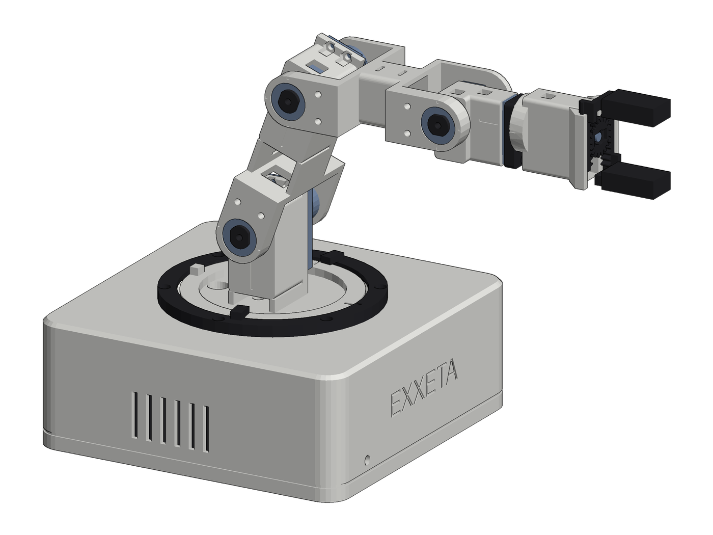

## The arm

| # | Picture | File | Print | What it does |
|---|---|---|---|---|
| 01 | 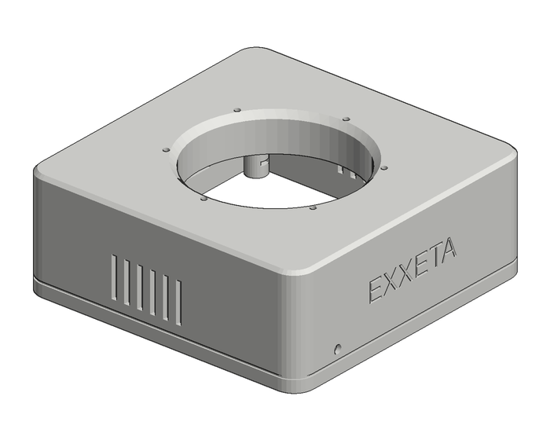 | `01_base_shell_1x.stl` | 1 × , 221.4 g each, body colour | the heavy, closed base. Its deck carries the lower half of the J1 ball race; a skirt below the deck holds the J1 servo bracket. All electronics, the battery and the wiring live inside (mounting details for the modules are added in Phase 5). |
| 02 | 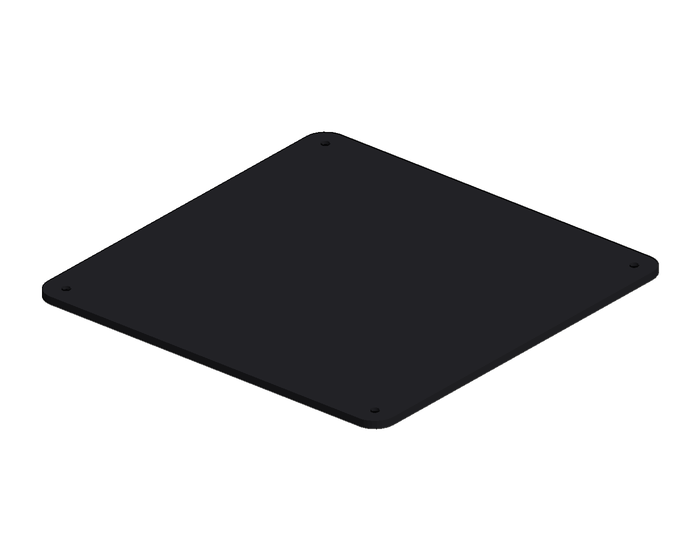 | `02_base_panel_1x.stl` | 1 × , 85.7 g each, accent colour | removable service cover (screwed, not snapped). The battery holders and the heavier modules are mounted on it in Phase 5, so the weight sits as low as possible. |
| 03 | 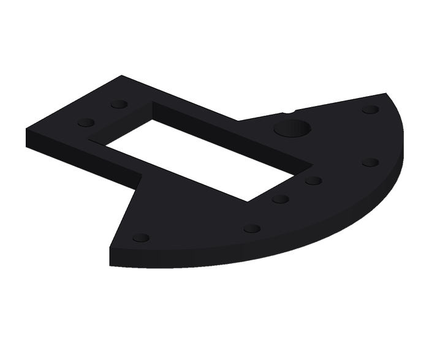 | `03_j1_bracket_1x.stl` | 1 × , 9.5 g each, accent colour | holds the base-yaw servo (MG996R, shaft up) under the turntable, and the optional J1 pot beside it. Screwed from below to four bosses inside the base. The servo only turns the turntable; the ball race carries the arm. |
| 04 | 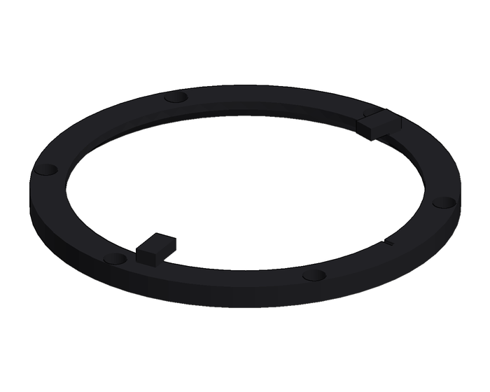 | `04_clamp_ring_1x.stl` | 1 × , 16.9 g each, accent colour | screwed onto the base deck after the turntable and the steel balls are in place. Its 45 degree face closes the ball race from above, so the turntable can take weight, side load and tipping moment without loading the J1 servo. Two tabs on top are the J1 end stops; a notch marks the J1 zero position. |
| 05 | 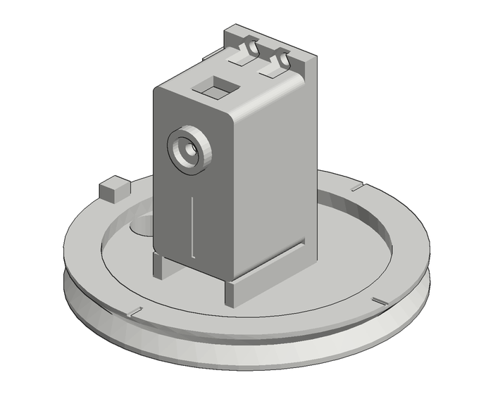 | `05_turntable_1x.stl` | 1 × , 68.6 g each, body colour | the rotating platform of J1 (base yaw). Its rim is the inner race of the printed ball bearing, its hub screws onto the J1 servo horn, and the tower on top holds the J2 (shoulder) servo. |
| 06 | 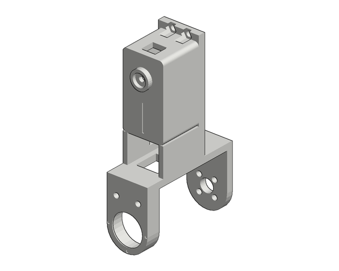 | `06_upper_arm_1x.stl` | 1 × , 35.6 g each, body colour | the first moving link. Its fork straddles the shoulder tower (J2); its far end is the housing of the elbow servo (J3). |
| 07 | 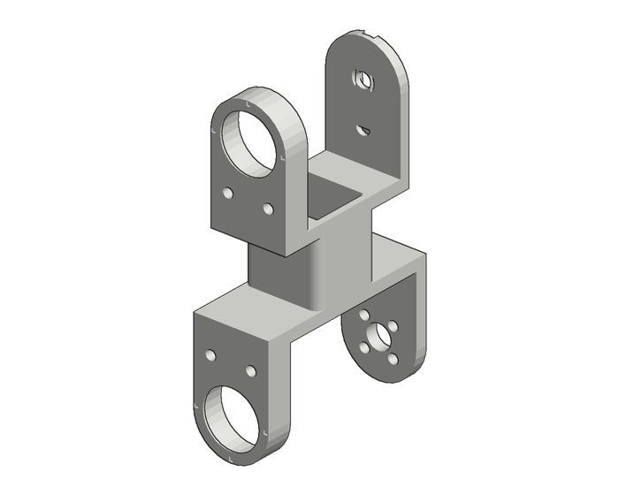 | `07_forearm_1x.stl` | 1 × , 31.1 g each, body colour | second moving link. A wide fork at the elbow (around the J3 servo housing), a hollow spine that carries the cables, and a narrow fork at the wrist. The wrist servo itself sits in the wrist block; this fork holds its horn on one side and the 608 bearing on the other (ADR-0005). |
| 08 | 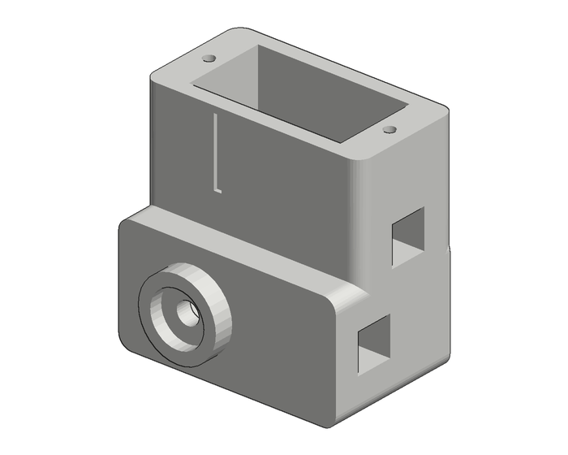 | `08_wrist_block_1x.stl` | 1 × , 12.2 g each, body colour | holds two MG90S servos. The J4 (wrist pitch) servo lies across the block with its shaft on the J4 axis; the J5 (wrist roll) servo stands in front of it with its shaft pointing along the hand. |
| 09 | 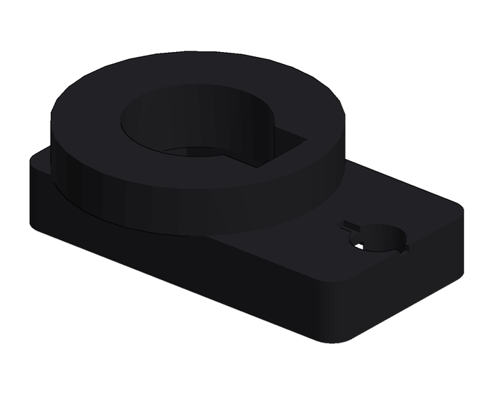 | `09_wrist_cap_1x.stl` | 1 × , 3.2 g each, accent colour | clamps the J5 servo by its ears and carries a round journal around the output shaft. The gripper turns on this journal, so sideways loads from the gripper go into the wrist block and not into the small servo shaft. |
| 10 | 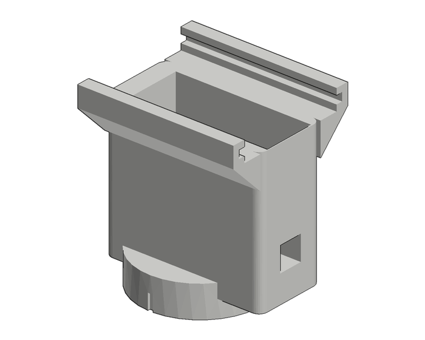 | `10_gripper_body_1x.stl` | 1 × , 17.4 g each, body colour | turns on the wrist cap journal (J5 roll), driven by the J5 servo horn that sits in a pocket of its base plate. It holds the J6 servo upright on the roll axis and guides the two racks of the parallel gripper (ADR-0006). |
| 11 | 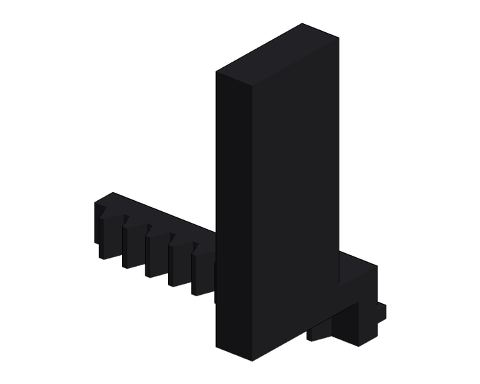 | `11_gripper_finger_2x.stl` | 2 × , 3.4 g each, accent colour | one sliding finger of the parallel gripper. The toothed bar (rack) meshes with the pinion on the J6 servo; a tongue on its back runs in the groove of the gripper body so the finger cannot lift out. The second finger is the same part turned 180 degrees about the hand axis, on the other side of the pinion. |
| 21 | 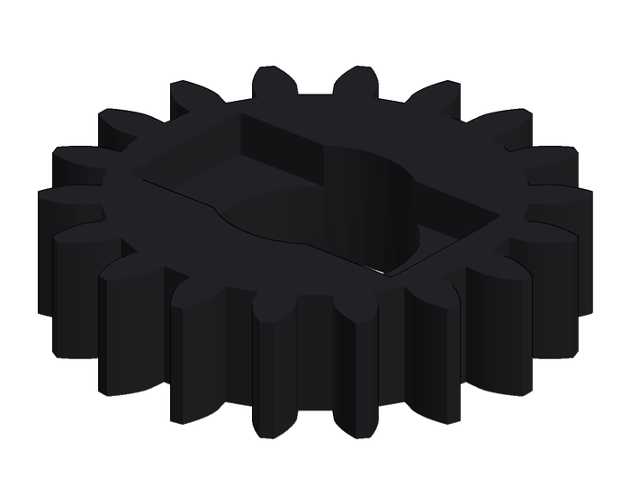 | `21_gripper_pinion_1x.stl` | 1 × , 0.9 g each, accent colour | the small gear on the J6 servo. It sits on the round boss of the servo; the servo horn (cut to 12 mm) drops into the pocket on top and its screw clamps everything, so the horn drives the pinion and the pinion drives both racks. |
| 12 |  | `12_fingertip_2x.stl` | 2 × , 2.5 g each, accent colour | swappable grip pad. A sleeve that slides over the end of a finger; the thick wall is the grip face. Print in TPU for grip, or in PETG and stick rubber/tape on. |
| 13 | 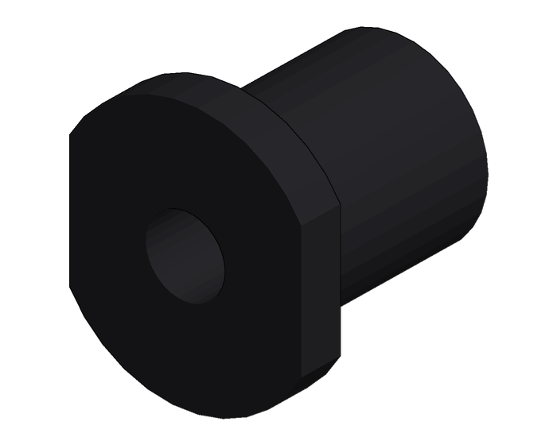 | `13_pivot_pin_3x.stl` | 3 × , 0.6 g each, accent colour | goes through the 608 bearing from the outside into the socket on the servo housing. An M3 x 16 screw through its centre clamps the inner ring of the bearing to the housing and carries the load. The flats on the head drive the optional pot. |
| 14 | 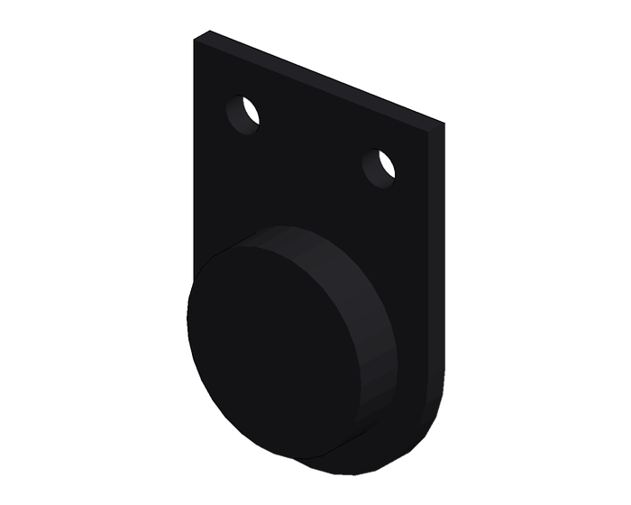 | `14_pivot_cover_3x.stl` | 3 × , 1.9 g each, accent colour | closes the bearing side of a pitch joint cleanly and keeps dust out of the 608 bearing. With a pot fitted, the pot pod (part 15) takes its place. |

## Optional parts

Parts 15, 16 and 17 are only needed if you fit pots (15 and 16 replace the pivot covers, part 14, on joints with a pot). Parts 18, 19 and 20 are test parts: **print 18 first**, then 19 and 20, before the big parts.

| # | Picture | File | Print | What it does |
|---|---|---|---|---|
| 15 | 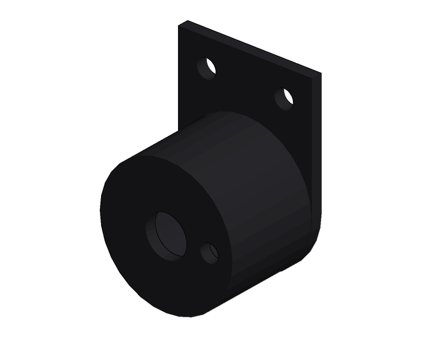 | `15_pot_pod_3x.stl` | 3 × , 4.0 g each, accent colour | holds a B10K rotary pot (WH148 type, 6 mm shaft, M7 bushing) on the joint axis, outside the bearing. The pot body is fixed to the fork (distal link); its shaft is turned by the pivot pin (fixed to the servo housing) through the loose pot coupler. The pot carries no load. |
| 16 | 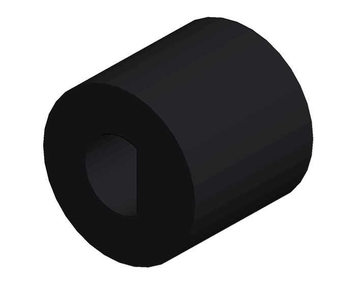 | `16_pot_coupler_3x.stl` | 3 × , 1.6 g each, accent colour | connects the flat-sided head of the pivot pin to the D-shaft of the pot. Both ends are a slightly loose fit, so small misalignment between pot and joint axis does no harm and the pot never carries load (PROJECT_SPEC 4.5). |
| 17 | 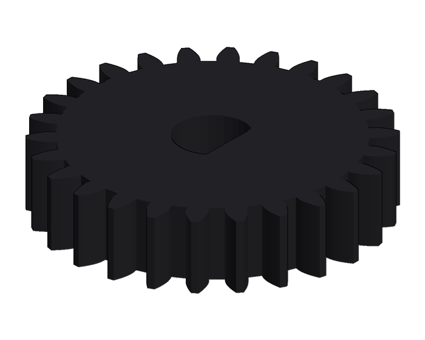 | `17_j1_pot_gear_1x.stl` | 1 × , 3.2 g each, accent colour | sits on the pot shaft and meshes 1:1 with the gear ring under the turntable, so the pot turns exactly as far as the base yaw joint. |
| 18 | 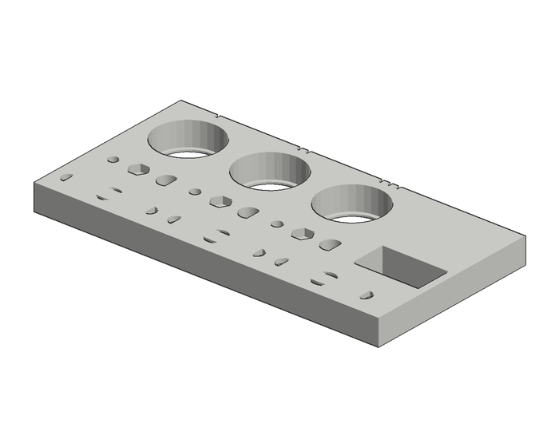 | `18_tolerance_test_1x.stl` | 1 × , 55.6 g each, body colour | every printer (and print service) makes holes a little differently. This small plate has each critical fit three times, at three clearances. Try your real bearing, nut, servo horn and pot in it, pick the fit that feels right, and put that value into `tolerances` in arm_params.json before printing the real parts. |
| 19 | 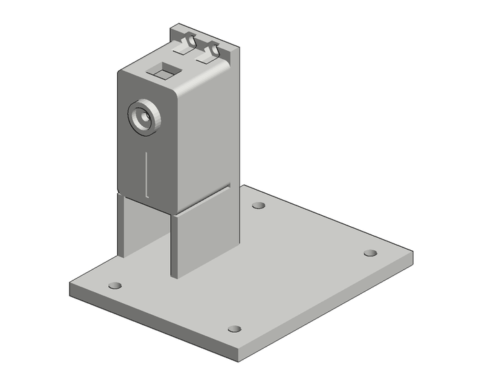 | `19_test_rig_stand_1x.stl` | 1 × , 57.2 g each, body colour | one MG996R housing on a foot, identical to the elbow and shoulder housings. Together with the test arm (part 20) it is a complete pitch joint on the bench: it checks that the servo, horn, bearing and pivot pin fit BEFORE the big parts are printed, and it is the rig for measuring real servo torque (hang a weight on the arm at 10 cm) and for the first firmware tests. |
| 20 | 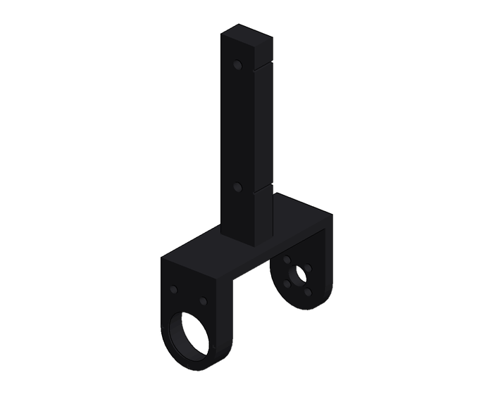 | `20_test_rig_arm_1x.stl` | 1 × , 29.5 g each, accent colour | the same fork as the upper arm and forearm, with a plain bar instead of a link. Two holes sit exactly 50 mm and 100 mm from the joint axis: hang a known weight there to measure the real torque of a servo (torque in kgf*cm = weight in kg x distance in cm). |

## Also in the arm, not printed

3 × MG996R servo (J1, J2, J3), 3 × MG90S servo (J4, J5, J6), 3 × metal servo horn, 3 × 608ZZ bearing, 46 steel balls 6 mm, M3 screws and nuts. See the [BOM](../../../docs/build/bom.md).
