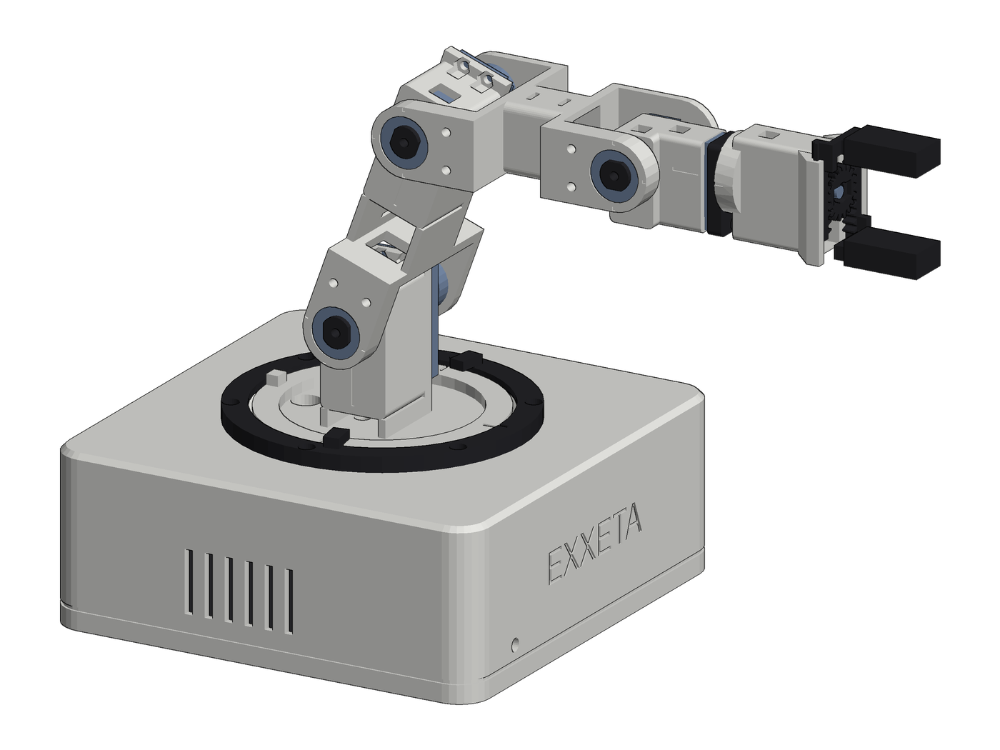
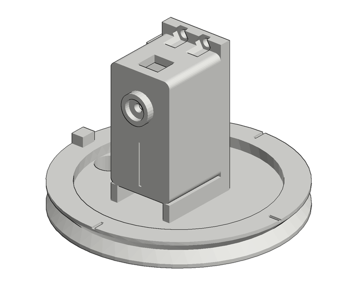
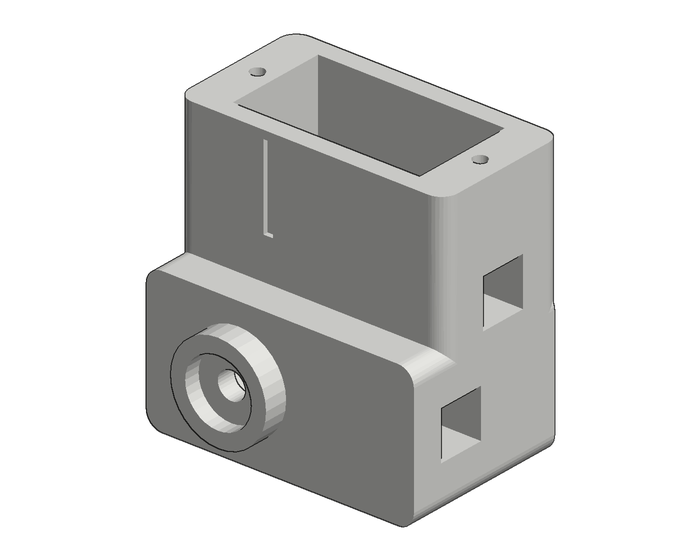
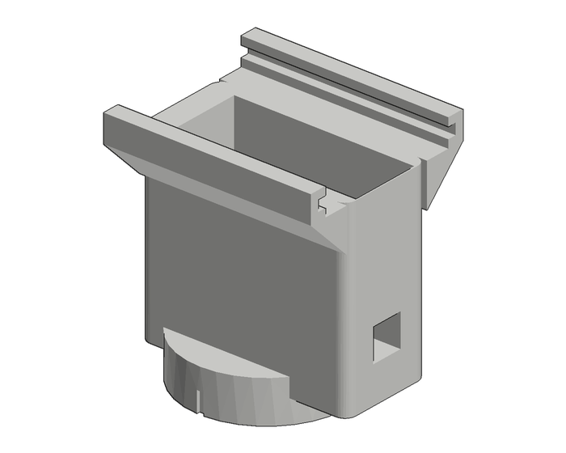
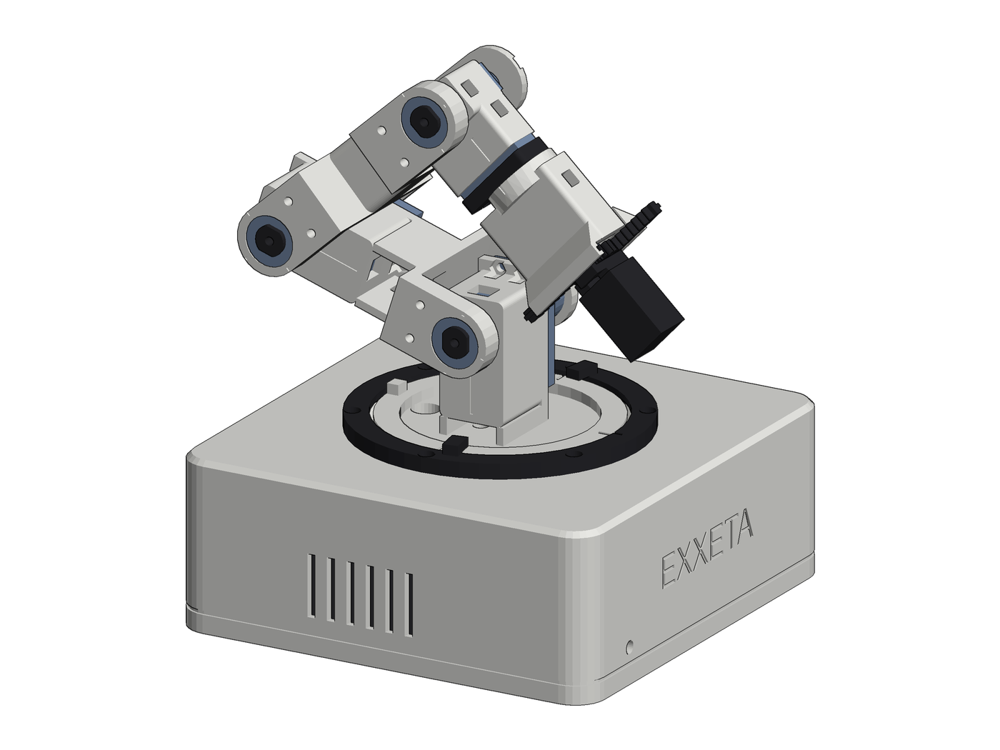

# Assembly guide

> **Not yet built from these instructions.** They follow the CAD. Expect small corrections after the first build; note them here.

Before you start: [print guide](print_guide.md) (tolerance test first), [BOM](bom.md), [wiring guide](wiring_guide.md). Part numbers below are the numbers in the STL file names.

## How every pitch joint works (J2, J3, J4)

A hobby servo has one output shaft and it must not carry bending loads. So each joint is a fork around a servo housing:

- **one fork arm is screwed to the servo horn** and transmits the torque;
- **the other fork arm holds a 608 bearing** on a pivot pin, exactly opposite the horn, and carries the load.

Understand this on the test rig (parts 19, 20) before building the arm: it is the same joint.

## 0. Prepare the servos

1. Label the servos J1…J6 with tape: MG996R for J1–J3, MG90S for J4–J6.
2. **Set every servo to its "joint at 0°" position** before it goes in. A 180° servo cannot cover a range like −50° … +120° around its centre, so each servo is mounted with its centre in the *middle of the joint's range*. Connect the servo and send this pulse from the firmware CLI ([bench test](../firmware/bench_test.md)); then assemble the joint at its 0° marks:

   | Joint | Range | CLI command | Assemble with |
   |---|---|---|---|
   | J1 | −90 … 90 | `pulse 1 1500` | arm facing the front |
   | J2 | −72 … 90 | `pulse 2 1400` | upper arm straight up |
   | J3 | −50 … 120 | `pulse 3 1111` | forearm in line with the upper arm |
   | J4 | −85 … 85 | `pulse 4 1500` | hand in line with the forearm |
   | J5 | −85 … 85 | `pulse 5 1500` | fingers moving left-right |
   | J6 | 0 … 160 | `pulse 6 611` | fingers closed |

   If a joint turns the wrong way later, do not rebuild it: calibration handles reversed direction. The spline only allows steps of about 14° to 18°, so the marks will be a few degrees off; calibration removes that too.
3. Cut **two** MG90S double-arm horns down to 12 mm total length (6 mm each side of the centre) with side cutters: one for J5, one for J6.
4. Press an M3 nut into every nut pocket now. A drop of glue or a strip of tape keeps loose ones in place.

## 1. Base and turntable (J1)

1. Screw the J1 servo (MG996R, shaft up, body towards the front) to the **J1 bracket (03)** with 4 × M3 × 10 and nuts.
2. Screw the bracket to the four bosses inside the **base shell (01)** from below with 4 × M3 × 10.
3. Mount a metal horn on the J1 servo. Do not tighten its centre screw fully yet.
4. Lightly grease the groove. Set the **turntable (05)** onto the horn so that its front mark faces the front of the base, and screw it to the horn with 4 × M3 × 8 from above.
5. Drop **46 steel balls** into the gap all round. Rotate the table by hand to spread them.
6. Fit the **clamp ring (04)** with its notch at the front and the two tabs at the back, 6 × M3 × 12. Tighten evenly, a little at a time, until the table turns smoothly with no rocking. If it binds, put paper shims under the ring.
7. If the turntable sits too high or too low on the horn (the balls take no weight, or the table cannot turn), adjust with washers under the horn or by how far the horn sits on the spline. Then tighten the horn's centre screw through the hole in the turntable.

## 2. Shoulder (J2)

1. Push the J2 servo (centred) into the tower of the turntable from the horn side; its cable leaves through the notch at the bottom. Fix it with 4 × M3 × 10.
2. Mount a metal horn.
3. Press a **608 bearing** into the bearing arm of the **upper arm (06)** from the inside. It must slide in by hand.
4. Slide the upper arm's fork over the tower with the arm pointing **straight up**. Screw the thin fork arm to the horn with 4 × M3 × 8.
5. Push a **pivot pin (13)** through the bearing into the socket on the back of the tower and fix it with an M3 × 16 screw. Do not overtighten: the fork must still turn freely.
6. Check the alignment marks: the tick on the bearing arm lines up with the line on the tower at 0°.
7. Fit a **pivot cover (14)** with 2 × M3 × 12 (or the pot pod, if you use pots).

## 3. Elbow (J3)

Exactly as the shoulder: J3 servo into the housing at the end of the upper arm, horn, bearing into the **forearm (07)**, fork over the housing with the forearm in line with the upper arm, 4 × M3 × 8, pivot pin, cover.

## 4. Wrist (J4, J5)

1. J4 servo (centred) into the cross pocket of the **wrist block (08)**, fixed with the two small screws from its bag. Fit its **full-length** double-arm horn pointing along the hand, and tighten the horn screw.
2. J5 servo into the front pocket, shaft pointing forward. Put the **wrist cap (09)** over it and fix both with 2 × M2 × 10 through the cap and the servo ears.
3. Bearing into the forearm's wrist fork. Slide the fork over the wrist block so the horn drops into the horn-shaped pocket of the thin fork arm. Pivot pin, M3 × 16, cover.

## 5. Gripper (J6)

1. Put a **trimmed horn** into the pocket in the floor of the **gripper body (10)**, set the body onto the wrist cap's journal so the horn engages the J5 shaft with the alignment marks at 0°, and tighten the horn screw from above (long thin screwdriver).
2. Slide both **fingers (11)** into the guides from opposite ends, teeth facing inwards, until the pads would touch in the middle. They must slide freely by hand. If not, clean the grooves; do not force them.
3. Lower the J6 servo (still at its "fingers closed" pulse) into the body, shaft up, and fix it with its two screws.
4. With the fingers closed, drop the **pinion (21)** over the servo's output so it meshes with both racks, put the second trimmed horn into its pocket and tighten the horn screw.
5. Push the **fingertips (12)** onto the fingers.

## 6. Cables and closing

1. Route the servo leads as described in the [wiring guide](wiring_guide.md): down the back of each link, a loop at each joint, through the hole in the turntable.
2. Move every joint through its full range by hand and watch the cables.
3. Wire the electronics, run the [bench test](../firmware/bench_test.md), then screw on the **bottom panel (02)** with 4 × M3 × 12 and stick on the feet.

## 7. Park and calibrate

Fold the arm into the **rest pose**: upper arm leaning back on its stop, forearm folded forward, hand hanging down.

The arm must always be in this pose when it is switched on, because without sensors the firmware assumes it. Continue with the [calibration guide](calibration_guide.md).
