# Print guide

> **Generated file.** Regenerate with `python tools/export_all.py`. STL files are in `cad/export/stl/`.

## Before you print anything big

1. **Measure your servos** and correct `servo_mech` in `cad/params/arm_params.json` if they differ.
2. Print **18_tolerance_test**. Try a 608 bearing, an M3 nut, an MG90S horn and a pot shaft in it. Put the clearances that fit into `tolerances` in the params and run `python tools/export_all.py` again.
3. Print the **single-joint test rig** (parts 19 and 20, plus one pivot pin and one pivot cover). It is one complete shoulder/elbow joint: if the servo, horn, bearing and pin fit here, they fit in the arm.

## Settings

- **Material:** PETG (PLA+ also works; PETG is tougher and survives a warm room). Fingertip pads: TPU.
- **Nozzle 0.4 mm, layers 0.2 mm** (0.1 to 0.15 mm for the pinion and the pot gear).
- **3 perimeters, 4 top/bottom layers, 25 % infill** unless the part says otherwise. Most walls are 2.4 to 4 mm thick, so the parts come out nearly solid; the mass estimates assume that.
- **Two colours:** parts marked *accent* are meant for the second colour (dark in the renders).
- Every part fits a 220 x 220 x 250 mm printer.
- Arm links lie on their flat back face. That keeps the layers running along the link, which is the strong direction.

## Parts

| # | Part | Qty | Colour | Material | Mass each (g) | Orientation | Supports | Notes |
|---|---|---|---|---|---|---|---|---|
| 01 | 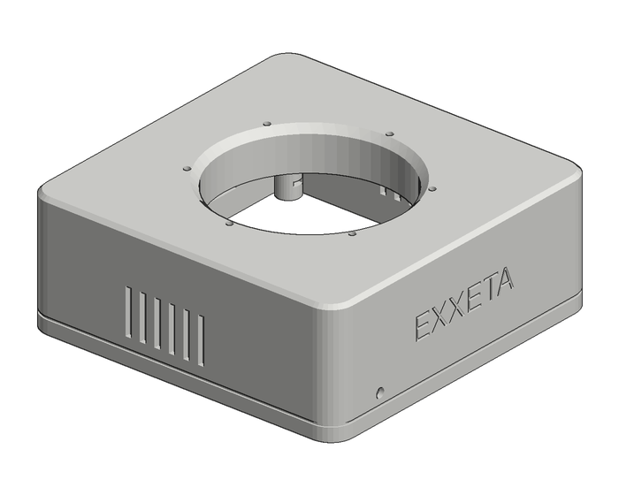 `base_shell` | 1 | body | PETG | 221.4 | upside down (deck on the bed) | none | Largest part (170 x 170 x 65). 3 perimeters, 15 % infill. The lower ball-race face is on the deck: use a clean, level bed. |
| 02 | 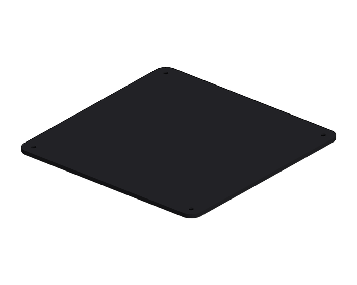 `base_panel` | 1 | accent | PETG | 85.7 | flat, outside face down | none | 4 x M3 x 12 into the corner posts. Stick 4 rubber feet (12 mm) into the round seats. |
| 03 | 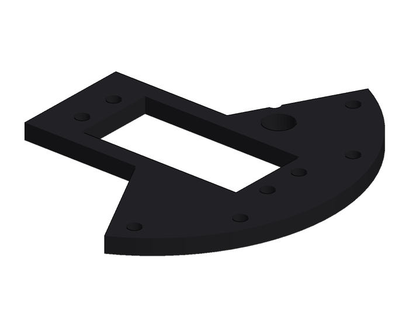 `j1_bracket` | 1 | accent | PETG | 9.5 | flat, top face up | none | 5 perimeters or 60 % infill: it takes the J1 servo torque. |
| 04 | 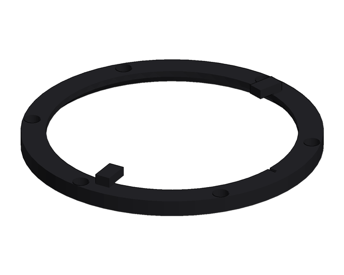 `clamp_ring` | 1 | accent | PETG | 16.9 | upside down (flat top face on the bed) | none | 6 x M3 x 12. Tighten evenly until the turntable turns smoothly without rocking; add paper shims under the ring if it binds. |
| 05 | 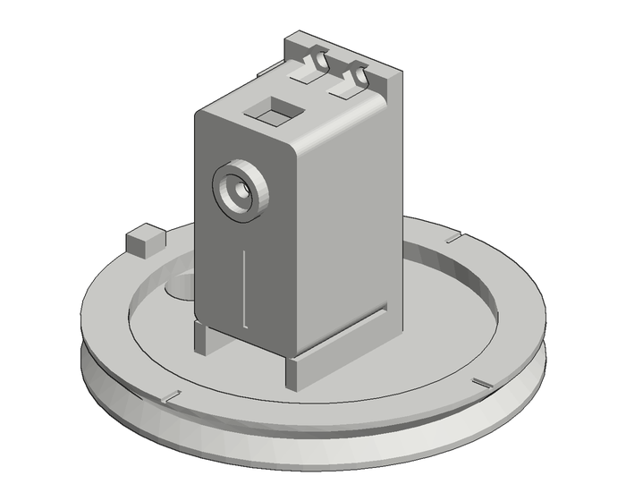 `turntable` | 1 | body | PETG | 68.6 | as modelled: disc flat on the bed, tower pointing up | none (45 degree groove, short bridges) | Inner race of the J1 ball bearing: print slowly with 0.2 mm layers for a smooth groove. |
| 06 | 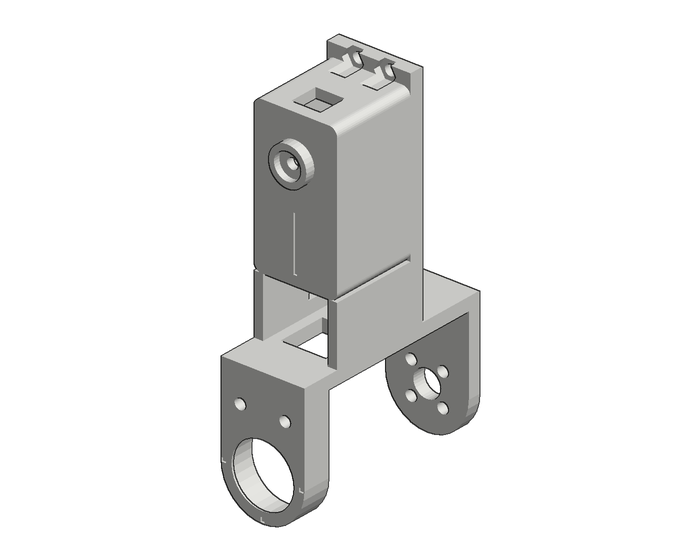 `upper_arm` | 1 | body | PETG | 35.6 | lying on the flat back (-X) face | none; the servo pocket roof is a 41 mm bridge | 4 perimeters. The 608 seat must be a sliding fit: check with the tolerance test first. |
| 07 | 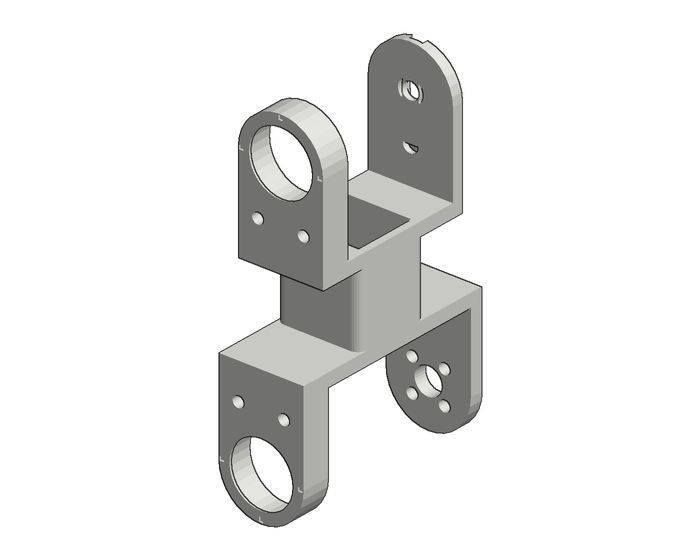 `forearm` | 1 | body | PETG | 31.1 | lying on the flat back (-X) face | none | The horn pocket must grip the MG90S double-arm horn: check with the tolerance test first. |
| 08 | 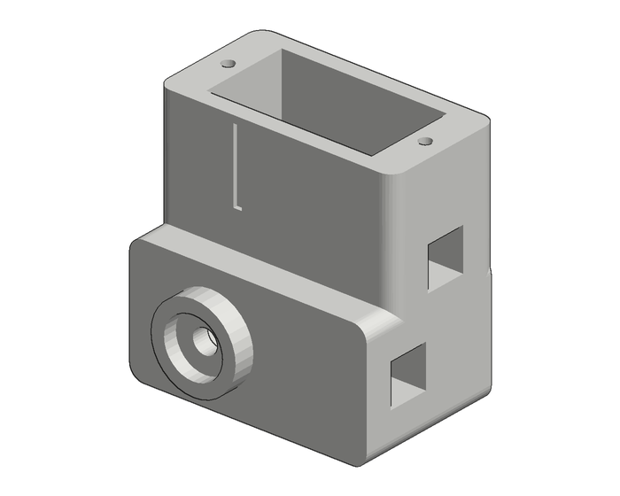 `wrist_block` | 1 | body | PETG | 12.2 | standing on the -Z face (J5 pocket opening up) | none | Thin walls: 3 perimeters, 100 % infill is fine (tiny part). |
| 09 | 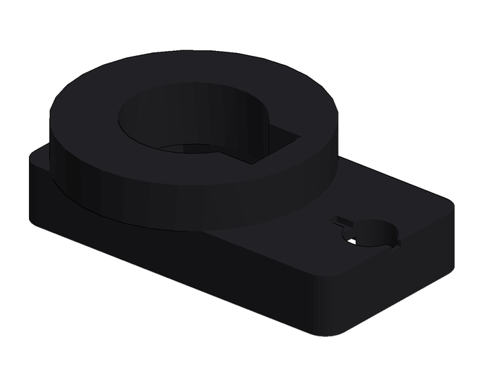 `wrist_cap` | 1 | accent | PETG | 3.2 | as modelled (frame on the bed, journal up) | a little, under the top plate inside the frame | Fixed with two M2 x 10 self-tapping screws through the servo ears. |
| 10 | 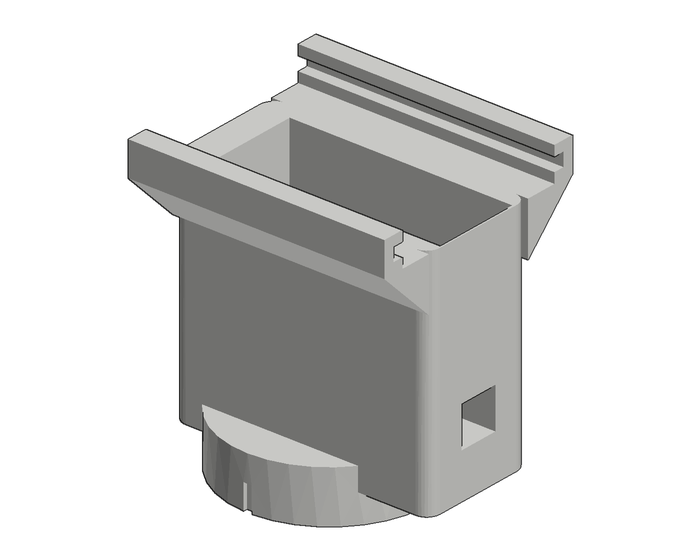 `gripper_body` | 1 | body | PETG | 17.4 | as modelled (skirt down) | under the base plate around the skirt | 3 perimeters, 40 % infill. The rack grooves must be clean: remove any stringing. |
| 11 | 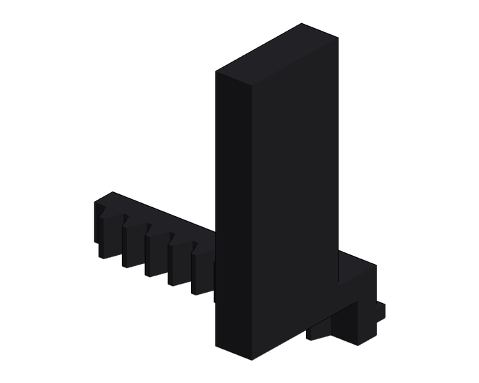 `gripper_finger` | 2 | accent | PETG | 3.4 | lying on its back (rack teeth pointing up) | a little under the finger | 100 % infill. Lightly grease the rack back and tongue. |
| 21 | 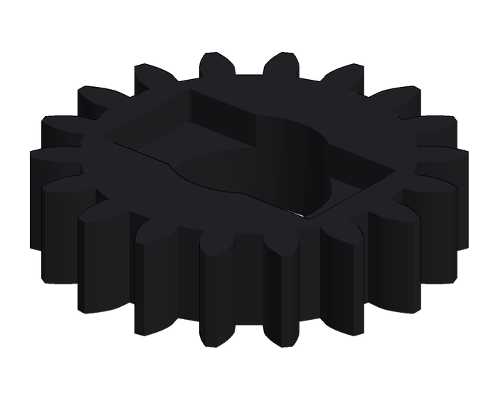 `gripper_pinion` | 1 | accent | PETG | 0.9 | flat, horn pocket up | none | 0.1 mm layers if possible. 100 % infill. |
| 12 |  `fingertip` | 2 | accent | TPU (or PETG + rubber tape) | 2.5 | open end up | none | Push fit. If loose, add a drop of glue or one wrap of tape on the finger. |
| 13 | 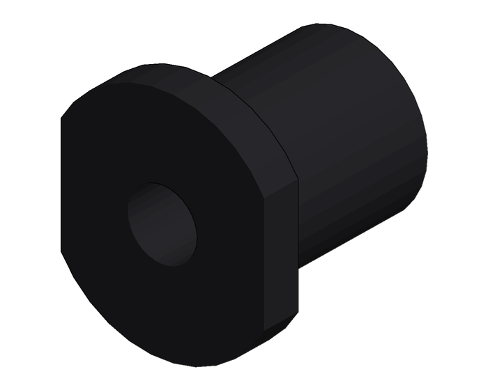 `pivot_pin` | 3 | accent | PETG | 0.6 | head down | none | 100 % infill. |
| 14 | 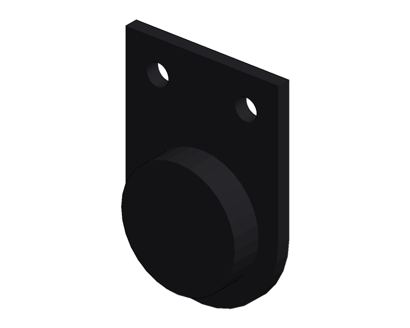 `pivot_cover` | 3 | accent | PETG | 1.9 | flat face down | none | 2 x M3 x 12 each, into the nuts in the fork arm. |
| 15 | 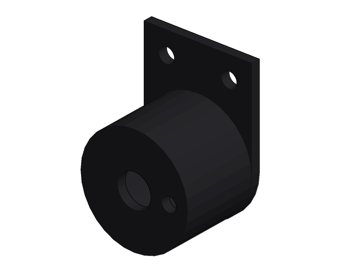 `pot_pod` *(optional)* | 3 | accent | PETG | 4.0 | flange down | none | Pot body outside, nut inside. Replaces the pivot cover on joints with a pot. |
| 16 | 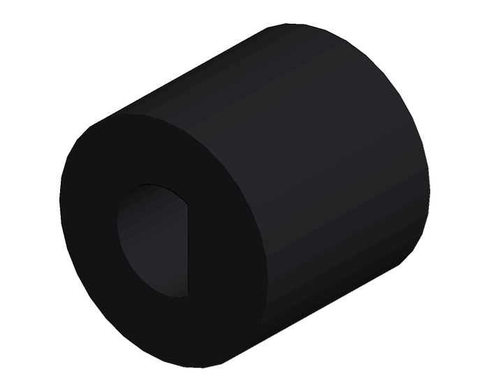 `pot_coupler` *(optional)* | 3 | accent | PETG | 1.6 | standing, pot end up | none | For knurled (split) pot shafts set options.pot_shaft = knurled6 and drill the socket to 6 mm. |
| 17 | 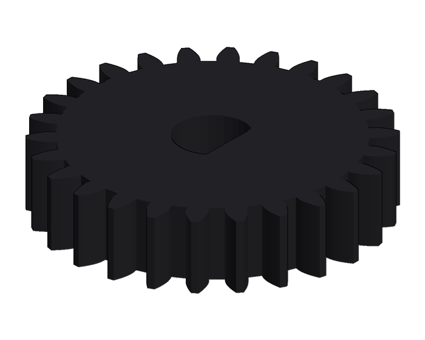 `j1_pot_gear` *(optional)* | 1 | accent | PETG | 3.2 | flat | none | 0.1 mm layers if possible (1 mm module teeth). |
| 18 | 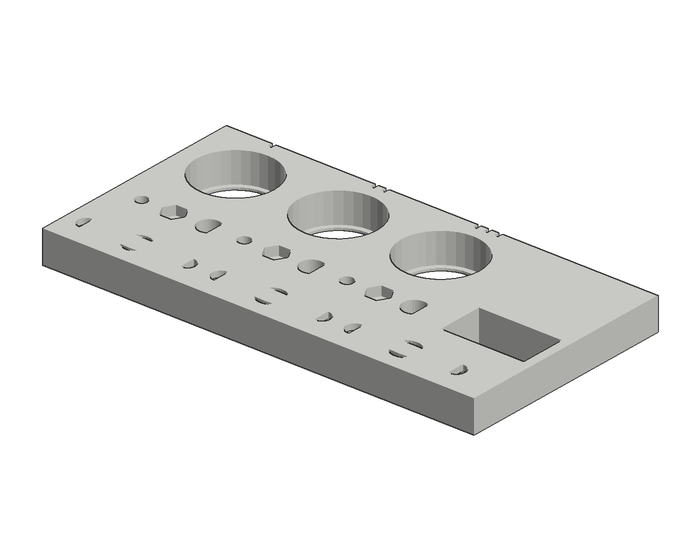 `tolerance_test` *(optional)* | 1 | body | PETG | 55.6 | flat | none | Print with exactly the material and settings planned for the arm. |
| 19 | 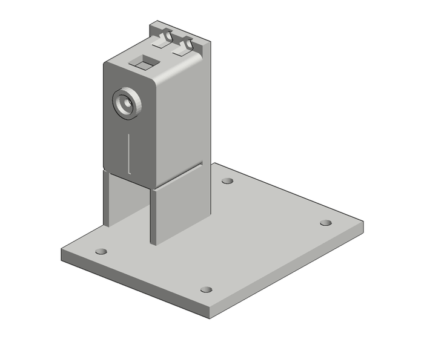 `test_rig_stand` *(optional)* | 1 | body | PETG | 57.2 | lying on the -X face (same as the arm links) | none | Clamp it to the table edge before hanging weights on the arm. |
| 20 | 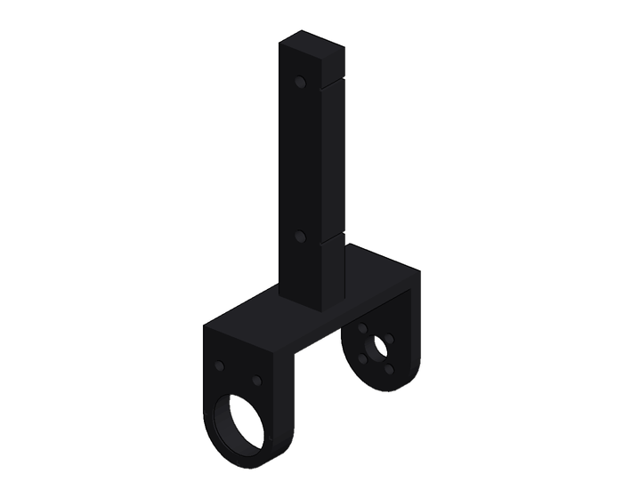 `test_rig_arm` *(optional)* | 1 | accent | PETG | 29.5 | lying on the -X face | none | Uses one 608 bearing, one pivot pin and one metal horn: the real parts, reusable in the arm. |

Optional parts are only needed with pots (15, 16, 17) or for testing (18, 19, 20).
