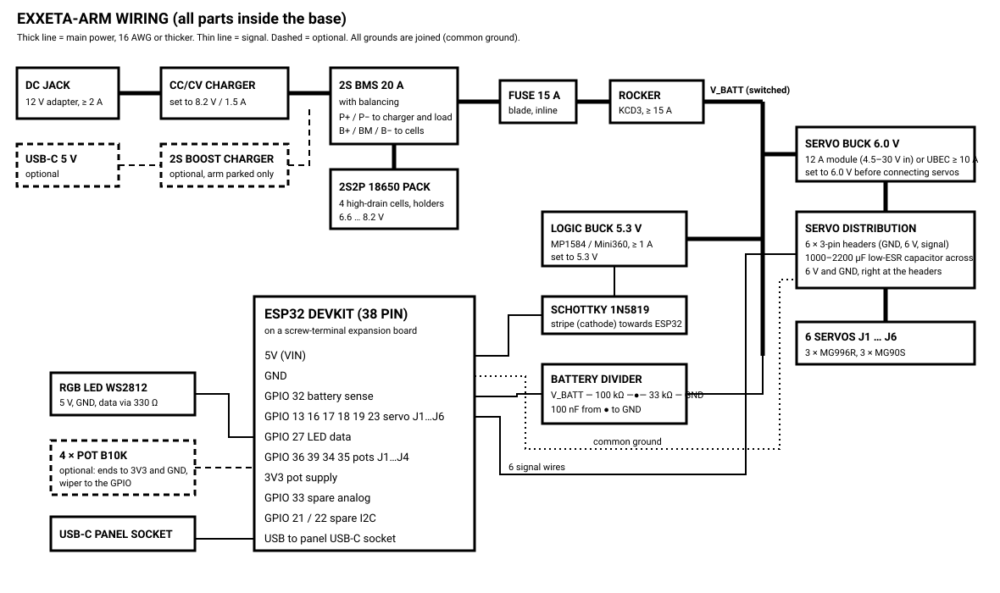

# Wiring guide

Pin numbers: [pin map](../hardware/pinmap.md). Reasons for the choices: [ADR-0003](../decisions/ADR-0003-power-system.md).

> **Not built yet.** This guide follows the design; no board has been wired from it. Check each step with a multimeter as you go.

## Read first: lithium-ion safety

- Use genuine high-drain cells in **cell holders**. Never solder to a cell.
- Check polarity twice before the cells go in. A reversed cell destroys the BMS at once.
- The **fuse goes in before anything else** is connected to the pack.
- Never charge unattended, never use a dented, rusty or swollen cell.
- Work with the cells **out** of the holders until the checklist at the end says otherwise.

## Tools and settings before you start

- Multimeter, small screwdriver for the trimmers, soldering iron, 16 AWG silicone wire (red, black) and thin wire for signals.
- A bench supply or any 9–12 V adapter for setting the converters.

## Step 1: set the three converters (no battery, no ESP32, no servos connected)

Feed each module from 9–12 V and turn its trimmer while measuring the output:

| Module | Set to | Why |
|---|---|---|
| Servo buck | **6.0 V** | servo rail |
| Logic buck | **5.3 V** | 5.0 V at the ESP32 after the diode drop |
| CC/CV charger: voltage trimmer | **8.20 V** with nothing connected | 4.10 V per cell |
| CC/CV charger: current trimmer | **1.5 A** into a short through the multimeter's 10 A range, or follow the module's instructions | gentle charge current |

Mark each module with tape once it is set.

## Step 2: battery, BMS, fuse, switch

1. Wire the two 2-cell holders as **2S2P**: two cells in parallel, then the two pairs in series.
2. Connect the BMS: `B−` to pack minus, `BM` to the middle point between the pairs, `B+` to pack plus.
3. From BMS `P+`: inline **15 A fuse**, then the **rocker switch**, then the node `V_BATT`. From BMS `P−`: ground.
4. The charger output goes to BMS `P+` / `P−` **before** the fuse and switch, so the pack charges with the arm switched off.
5. All of this in **16 AWG or thicker**.

## Step 3: rails

1. `V_BATT` and ground to the input of the **servo buck**. Its output goes to the servo distribution board with the **1000–2200 µF capacitor** soldered across 6 V and ground right at the headers (mind the polarity stripe).
2. `V_BATT` and ground to the **logic buck**. Its output goes through the **1N5819** (stripe towards the ESP32) to the ESP32 `5V` pin. The diode stops USB power and battery power from feeding each other.
3. **Divider:** 100 kΩ from `V_BATT` to GPIO 32, 33 kΩ from GPIO 32 to ground, 100 nF across the 33 kΩ.
4. **Join the grounds**: servo rail ground and ESP32 ground must be connected. Without it the servos twitch or ignore the signal.

## Step 4: signals

1. Six servo signal wires from GPIO 13, 16, 17, 18, 19, 23 to the signal pins of the J1…J6 headers.
2. LED: 5 V, ground, data from GPIO 27 through a 330 Ω resistor.
3. USB-C panel socket to the ESP32's USB port (short cable inside the base).
4. Optional pots: outer pins to `3V3` and ground, wiper to GPIO 36 / 39 / 34 / 35 (J1–J4). **Never feed a pot from 5 V**: the ESP32 inputs take 3.3 V at most.

## Step 5: checklist before the cells go in

- [ ] Fuse fitted, switch **off**.
- [ ] No short between `V_BATT` and ground (multimeter in resistance mode).
- [ ] Converters set and marked (step 1).
- [ ] Capacitor polarity correct.
- [ ] Servos **not** plugged in yet.

Then: insert the cells, switch on, measure 6.0 V on the servo headers and 5.0 V at the ESP32 `5V` pin. Only now plug in the servos and continue with the [bench test](../firmware/bench_test.md).

## Servo leads

The MG90S leads are about 25 cm long and will not reach from the hand to the base. Use **servo extension leads** for J4, J5 and J6 (30 cm) and for J3 if needed. Route them along the back of the links, hold them with small zip ties through the slots, and leave a loose loop at every joint. Move each joint through its whole range by hand and check that no lead is pulled tight or pinched. The bundle passes through the 11 mm hole in the turntable behind the shoulder.

## Still open (Phase 5)

The base shell has no mounting points for the modules yet, and the rear panel (switch, DC jack, USB-C cut-outs) is not designed, because the exact modules are not chosen. Until then: mount the modules on the bottom panel with double-sided foam tape, converters away from the cells.
